## 🚀 About Me

- 🎓 B.E. in CSE (AI & ML), Nagarjuna College of Engineering and Technology
- 🔬 I build applied AI systems, from model development to web applications
- 🎯 Focus: CPU deployment, dataset auditing and model evaluation

## 🛠️ Tech Stack

## 📊 Research Results

## 💡 Projects at a Glance

<b>📖 Read full project details</b>

## 🔬 Featured Research

### 🤟 SignBridge AI
*A CPU-Deployable Multi-Model Framework for Static American and Indian Sign Language Recognition*

- Three independent MobileNetV3-Small models
- FastAPI web app with camera capture, image upload and Top-3 predictions
- Editable message composition and browser-based text-to-speech

| Model | Classes / Labels | Reported Test Accuracy |
|---|:---:|:---:|
| ASL alphabet | 26 | **96.48%** |
| ISL alphabet | 26 | **94.62%** |
| Everyday signs | 44 | **90.79%** |

### 🩺 Breast Cancer Detection
Mammogram image classification using deep learning, transfer learning and feature selection, with a study of patient-level data splitting and model robustness.

## 🛠️ Projects

| Project | What it does | Tech |
|---|---|---|
| 🌾 **Krushak Hithaishi** | Crop disease detection, weather-aware advice, multilingual farmer help and treatment procurement support | Python, MobileNetV3, FastAPI, Open-Meteo |
| 💊 **RefillFlow AI** | Prescription refill workflow: Detect → Route → Act → Verify, with status tracking and approvals | Python, FastAPI, JavaScript, React/Vite |
| ♻️ **Trash to Tech** | Classifies plastic, wood, e-waste, metals and glass | Python, TensorFlow, Keras, OpenCV |
| 😊 **AI Motivator** | Personalized motivation for Happy, Sad, Bored and Mixed moods | Python, AI/ML, Web Development |

⭐ *Thanks for visiting my profile!*

